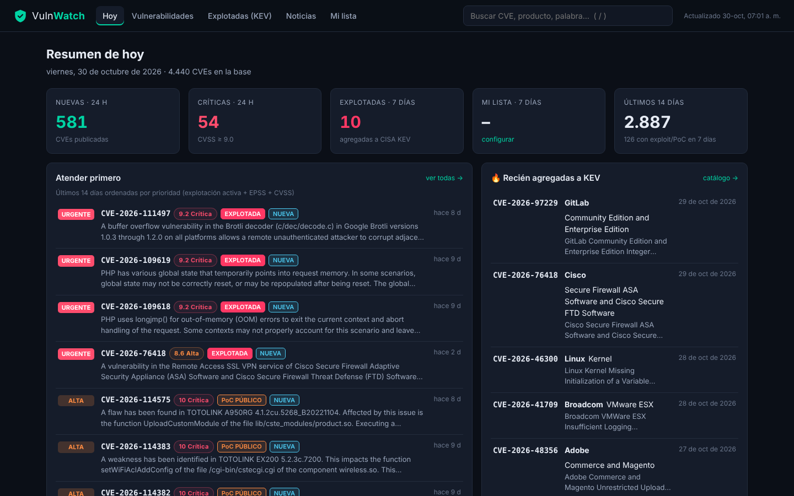
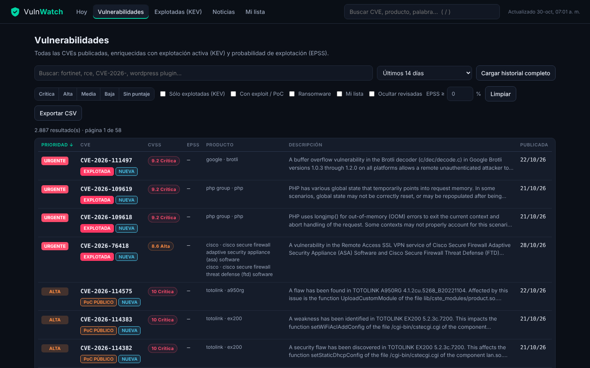
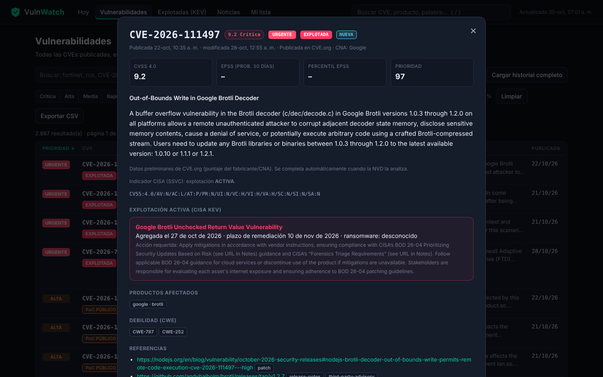
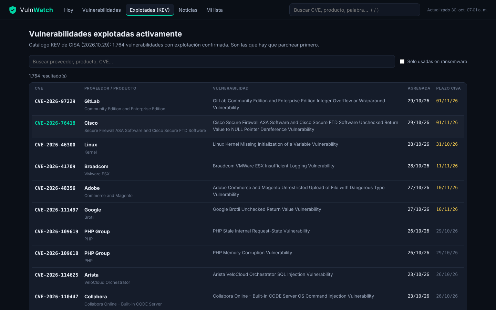
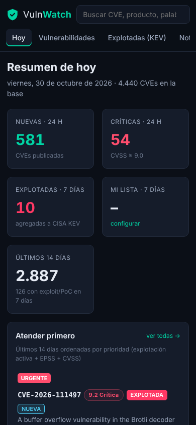
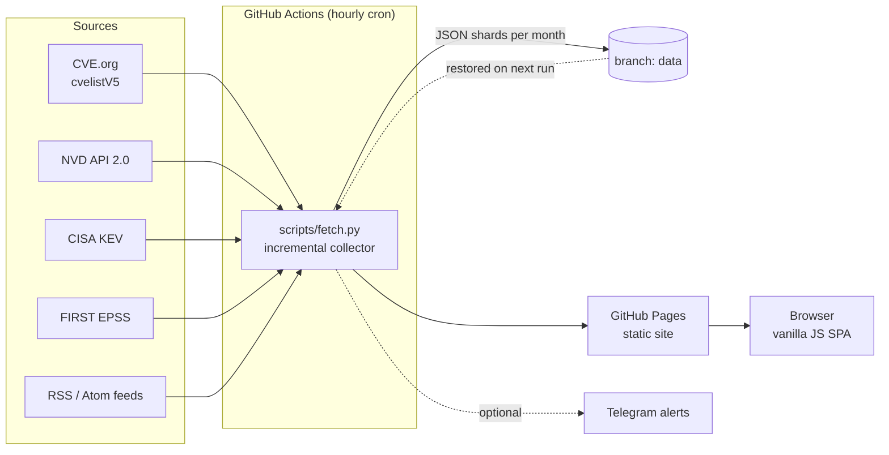

# VulnWatch 🛡

> 🇪🇸 [Leer en español](README.es.md)

**Vulnerability intelligence dashboard that tracks every new CVE as it is published, flags the ones being actively exploited, and ranks them by real-world risk. It updates itself every hour and runs 100% free on GitHub Actions + GitHub Pages.**

[](https://ulisespignatelli.github.io/vulnwatch/)
[](https://github.com/ulisespignatelli/vulnwatch/actions/workflows/tests.yml)
[](https://github.com/ulisespignatelli/vulnwatch/actions/workflows/codeql.yml)
[](https://github.com/ulisespignatelli/vulnwatch/actions/workflows/update.yml)


[](LICENSE)

**🔗 Live: https://ulisespignatelli.github.io/vulnwatch/**



## Why

More than 100 CVEs are published every day, and CVSS alone is a poor signal: most "critical" bugs are never exploited, while some "medium" ones end up in ransomware campaigns. In pentesting and vulnerability management, the useful question is **"what is being exploited right now, and does it affect my targets?"**

VulnWatch answers that by combining several public sources into one prioritized view:

| Signal | Source | What it tells you |
|---|---|---|
| New CVEs (minutes after publication) | [CVE.org](https://github.com/CVEProject/cvelistV5) | Everything that comes out, before NVD analysis |
| Enriched CVE data | [NVD API 2.0](https://nvd.nist.gov/developers) | CVSS, CPE (affected products), CWE |
| Confirmed exploitation | [CISA KEV](https://www.cisa.gov/known-exploited-vulnerabilities-catalog) | Exploited in the wild, ransomware use, remediation deadlines |
| Public exploit / PoC | CISA Vulnrichment (SSVC) | `none` / `poc` / `active` |
| Exploitation probability | [FIRST EPSS](https://www.first.org/epss/) | Probability of exploitation in the next 30 days |
| Context | 12 security news feeds (RSS/Atom) | News linked to the CVEs they mention |

## Features

- **Daily overview:** new and critical CVEs in the last 24 h, recent KEV additions, a **"fix first"** ranking, daily volume by severity, and the latest news.
- **Full CVE explorer:** full-text search, filters (severity, KEV, exploit/PoC, ransomware, EPSS threshold, watchlist), column sorting, month-by-month history and CSV export.
- **CVE detail:** CVSS vector, EPSS score and percentile, KEV data, affected products, CWE, references, related news, and a one-click search for public PoCs on GitHub.
- **Watchlist:** track the vendors and products in your scope. Matching CVEs are highlighted everywhere, and you can mark CVEs as reviewed.
- **Optional Telegram alerts:** new KEV entries, critical CVEs and watchlist matches.
- **Responsive:** works on a phone.

<table>
<tr><td></td><td></td></tr>
<tr><td></td><td align="center"></td></tr>
</table>

## Architecture



### Design decisions

- **Serverless and free.** A scheduled GitHub Actions job collects the data and publishes a static site. There is no server to maintain or patch.
- **Incremental sync.** NVD is queried by `lastModified` windows (≤120 days, as the API requires) with a safety overlap. CVE.org is followed through its `deltaLog`, and the sync resumes where it stopped if a run hits its fetch limit.
- **Source precedence.** A CVE first appears with the CNA's data from CVE.org and is upgraded when NVD analyzes it, without losing enrichment (KEV, EPSS, SSVC) or CNA scores that NVD doesn't provide.
- **Data outside the git history.** EPSS changes daily for almost every CVE, which would bloat the repo. The dataset lives in a separate `data` branch that is force-pushed on each run.
- **Risk-based priority** (see below) instead of sorting by CVSS.
- **Zero dependencies.** The collector uses only the Python standard library and the frontend is vanilla JS, which keeps the supply-chain risk small.
- **Self-healing.** If one source fails, the others still update and the next run catches up. The workflow re-enables itself so GitHub never disables the schedule for inactivity.

### Priority score

```
priority = CVSS × 4  +  EPSS × 45  +  60 if in CISA KEV
                                   (or +45 if SSVC exploitation = active, +15 if a public PoC exists)
                                   +15 if used in ransomware campaigns
```
→ **URGENT** (actively exploited or ≥ 70) · **HIGH** (≥ 40 or CVSS ≥ 9) · **MEDIUM** (≥ 22) · **LOW**

## Security

- Every string from external feeds is HTML-escaped, and links are restricted to `http(s)` on both the collector and the UI. This blocks `javascript:` URL injection from a malicious feed, and a regression test covers it.
- Secrets live only in GitHub Actions secrets, and each workflow declares least-privilege `permissions`.
- CodeQL (Python, JS, Actions) and Dependabot are enabled. See [SECURITY.md](SECURITY.md) to report issues.

## Deploy your own (≈10 min)

1. Fork or clone this repo and push it to your account (the repo must be public for free Pages).
2. **Settings → Pages → Source: GitHub Actions**.
3. *(Recommended)* Request a free [NVD API key](https://nvd.nist.gov/developers/request-an-api-key) and add it as the secret `NVD_API_KEY`.
4. **Actions → "Actualizar datos y publicar" → Run workflow.** The first run loads every CVE published since 2025-01-01.

Optional configuration (*Settings → Secrets and variables → Actions*):

| Name | Type | Purpose |
|---|---|---|
| `NVD_API_KEY` | secret | 10× faster NVD sync |
| `TELEGRAM_TOKEN`, `TELEGRAM_CHAT_ID` | secret | Telegram alerts |
| `WATCHLIST` | variable | Comma-separated keywords for alerts, e.g. `fortinet,exchange,vmware` |
| `BACKFILL_FROM` | variable | Load history from an earlier date, e.g. `2020-01-01` |
| `SOCIAL_HANDLE` | variable | Handle shown on the daily social card, e.g. `@UP_Ciberseguridad` |
| `SOCIAL_HOUR` | variable | UTC hour to auto-post the daily card to Telegram (default `12`) |
| `IG_USER_ID` | secret | Instagram Business account ID (optional, for auto-posting to Instagram) |
| `IG_ACCESS_TOKEN` | secret | Long-lived Facebook Page token with `instagram_content_publish` (optional) |

### Daily social card (Telegram + Instagram)
On each run VulnWatch renders a **ready-to-post image** with the day's top vulnerabilities plus a **caption with hashtags**, saved to the `data` branch at `social/today.png` and `social/today.txt`. If Telegram is configured, the card is **auto-posted once a day** (hour set by `SOCIAL_HOUR`). The image and caption are left ready to post manually. Optionally, with an Instagram **Business/Creator** account and a Meta app (`IG_USER_ID` + `IG_ACCESS_TOKEN` secrets), the card is **auto-published** to Instagram once a day too.

### Run locally

```bash
python3 scripts/fetch.py                  # collect real data (internet needed)
cd site && python3 -m http.server 8000    # open http://localhost:8000
python3 -m unittest discover -s tests -v  # unit tests (offline)
```

## Project structure

```
scripts/fetch.py      collector: CVE.org, NVD, KEV, EPSS, RSS → JSON
scripts/config.py     sources and settings (add or remove news feeds here)
site/                 static frontend (index.html, app.js, style.css)
tests/                unit tests and a mock end-to-end run
.github/workflows/    hourly update + deploy, tests, CodeQL
```

## Roadmap

- [ ] Spanish summaries of urgent CVEs generated by an LLM
- [ ] Static per-CVE and per-vendor pages (SEO)
- [ ] Public exploit tracking (Exploit-DB, Metasploit modules, GitHub PoCs)
- [ ] Daily digest as an RSS feed and a Telegram channel

## License

[MIT](LICENSE). Data belongs to its respective sources (NVD, CVE Program, CISA, FIRST and each news site).
